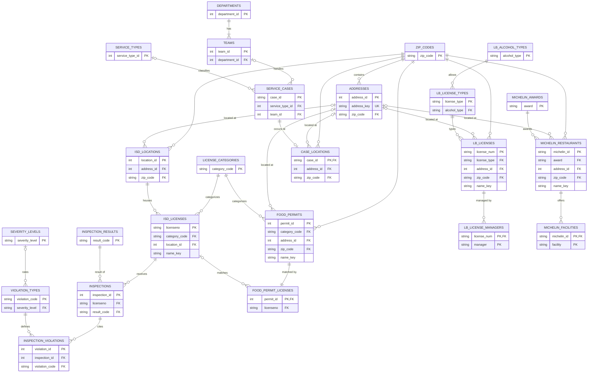

# CS3200 Project | Janet, Layla, Alexis, Ricky

# Boston Food Establishments & 311 Data

Boston city data on food establishments (licenses, permits, health inspections), Michelin-listed Boston restaurants, and 311 service requests. The raw files are cleaned by the scripts in `cleaning_files/`, then `normalize_all.py` turns the cleaned files into 24 linked 3NF tables in `normalized/`.

```
raw_data/                  original downloads
cleaning_files/            one cleaning script per raw dataset
cleaned_data/              cleaned CSVs (food_permits, lb_licenses, michelin_restaurants, 311_service_requests)
  food_violations/         cleaned inspection tables (licenses, locations, license_categories,
                           inspections, inspection_violations, violation_types)
normalize_all.py           cleaned_data/ -> normalized 3NF tables + schema.sql
normalized/                final tables
```

---

## 1. Original datasets

| File | Rows × Cols | Source | Description |
|---|---|---|---|
| `food_violations.csv` | 907,140 × 26 | Boston ISD | Food inspection history, 2006–2026. One row per cited code item per inspection, with license, owner, and address repeated on every row. |
| `food_establishment_licenses.csv` | 3,361 × 14 | Boston ISD | Active Eating & Drinking permits (FS / FT). No license number. |
| `all_establishment_licenses.csv` | 3,559 × 26 | Boston Licensing Board | Active Licensing Board licenses: victualler, alcohol, inn, club, misc. Coordinates are in MA State Plane. |
| `michelin_my_maps.csv` | 19,721 × 14 | Michelin Guide (Kaggle scrape) | Worldwide Michelin-listed restaurants. 15 are in Boston. |
| `service_requests.csv` | 79,999 × 28 | Boston 311 (new system) | 311 cases, Aug 2025 – Oct 2026. Likely a capped export. Columns are defined in `311_service_requests_data_dictionary.pdf`. |
| `data-dictionary.xlsx` | — | Boston Licensing Board | Column definitions for `all_establishment_licenses.csv`. |

---

## 2. Cleaning pipeline (`cleaning_files/`)

Each script reads one raw file from `raw_data/` and writes to `cleaned_data/`. Pass the output path explicitly, because the scripts' built-in default names differ from what `normalize_all.py` expects:

```
python cleaning_files/clean_violations.py              raw_data/food_violations.csv              cleaned_data/food_violations
python cleaning_files/clean_food_licenses.py           raw_data/food_establishment_licenses.csv  cleaned_data/food_permits.csv
python cleaning_files/clean_licensing_board_licenses.py raw_data/all_establishment_licenses.csv  cleaned_data/lb_licenses.csv
python cleaning_files/clean_michelin.py                raw_data/michelin_my_maps.csv             cleaned_data/michelin_restaurants.csv
python cleaning_files/clean_service.py                 raw_data/service_requests.csv             cleaned_data/311_service_requests.csv
```

**`clean_violations.py`** → `cleaned_data/food_violations/` (6 tables)
- Trimmed and collapsed whitespace in every column; empty strings become missing.
- Dropped rows whose license status is `Deleted`, which are test or deleted licenses.
- Uppercased state and city; removed trailing slashes from city and fixed `ROXBURY CROSSIN`.
- Cut ZIPs to 5 digits with a leading zero (`2108` → `02108`, `02108-1234` → `02108`).
- Treated `property_id` `0` as missing, and set invalid severity levels (anything other than `*`/`**`/`***`) to missing.
- Parsed issue, expiry, result, violation, and status dates as UTC timestamps.
- Split the `(lat, long)` location string into `latitude` and `longitude`.
- Split the data into six tables:
  - `license_categories`: one row per category code.
  - `locations`: one row per distinct address, ZIP, property, and coordinates, with a `location_id`.
  - `licenses`: one row per `licenseno`, with names, owners, dates, status, category, location, and `business_name_key`.
  - `inspections`: one row per license + result time + result, with an `inspection_id`.
  - `violation_types`: one row per violation code, with severity and description.
  - `inspection_violations`: one row per cited item, with exact duplicate rows removed and a `violation_id`.
- Checks that every license number is unique and that every foreign key resolves before writing.

**`clean_food_licenses.py`** → `cleaned_data/food_permits.csv`
- Trimmed whitespace and collapsed double spaces; dropped exact duplicate rows; renamed columns to snake_case.
- Standardized neighborhood spellings in `city` (mixed case, trailing slashes): 36 values → 16.
- Split the address into number and street name. ISD addresses have no street suffix.
- Padded ZIPs to 5 digits and added `zip_in_boston`.
- Formatted 10-digit phones and blanked invalid ones (placeholder `0`, 7-digit).
- Parsed `license_added` as UTC and added `license_added_year`.
- Blanked coordinates outside Boston.
- Added `record_id` (the file has no license number), `is_takeout`, `name_key` / `address_key` (from `business_name`, which is the public name here), and `licenses_at_site`.

**`clean_licensing_board_licenses.py`** → `cleaned_data/lb_licenses.csv`
- Kept only Common Victualler licenses, including the CV7 alcohol variants.
- Text cleanup:
  - Trimmed quotes and whitespace.
  - Blanked placeholders (`n/a`, `-`, `tbd`, capacity `0`, coordinates `0`).
  - Uppercased state and padded ZIPs.
- Hours:
  - Parsed opening, closing, and patrons-out times into `_24h` columns. The parser handles free text such as `To: 2:00 AM`, `MIDNIGHT`, and `11;00 PM`.
  - Added an `open_24_hours` flag.
- Dates: parsed issued and expires dates; added `is_expired`.
- Deduplicated after cleaning, then collapsed licenses listed once per manager into one row per license (managers joined with `; `). The script stops with an error if a license number is still duplicated.
- Addresses: split into number, range end, direction, name, and USPS suffix, producing `address_clean`.
- Coordinates: converted MA State Plane `gpsx`/`gpsy` to WGS84 lat/long, using pyproj if installed and the projection formulas otherwise.
- Phones: validated as US numbers and split off extensions.
- Added `display_name`, `name_key`, and `business_name_key`.
- Added `alcohol_type` / `serves_alcohol` from the license type, with a warning for unmapped types.

**`clean_michelin.py`** → `cleaned_data/michelin_restaurants.csv`
- Snake-cased columns and trimmed text.
- Filtered to `Boston, MA, USA`, which excludes Cambridge, Brookline, and Boston Spa, UK.
- Parsed street address and ZIP from the full address; formatted phones.
- Added:
  - `price_level` (1–4)
  - `stars`
  - `is_bib_gourmand`
  - green star as true/false
  - `michelin_id` (the Michelin URL slug)
- Separated facilities with `; ` instead of commas.
- Checked that every ID is unique, every ZIP is a Boston ZIP, and every coordinate is inside Boston.

**`clean_service.py`** → `cleaned_data/311_service_requests.csv`
- Trimmed text; dropped duplicate case IDs and the all-empty photo columns.
- Parsed dates as UTC; blanked close dates that come before the open date.
- Merged "Resolved successfully" into "Resolved" and filled blank service names from the case topic.
- Restored leading zeros on ZIPs; padded ward and precinct; converted district numbers to integers.
- Blanked coordinates outside Boston.
- Added `is_closed`, `is_intersection`, `sla_hours`, `hours_to_close`, `on_time_final`, Boston-local open time parts, and `zip_in_boston`.
- Reports closed cases whose `on_time` value disagrees with their dates.

---

## 3. Normalization (`normalize_all.py`)

```
python normalize_all.py                          # defaults: cleaned_data/ -> normalized/
python normalize_all.py <input_dir> <output_dir>
```

The script reads the six inspection tables from `cleaned_data/food_violations/` and everything else from `cleaned_data/`. It finds each file by base name (a `_1` suffix is fine) and writes 24 CSVs plus `schema.sql`. Before writing, it checks every primary key for uniqueness and every foreign key for orphans.

**Standardization across all sources**
- **Addresses:** one parser handles every source format: `122- Brighton AV`, `1321 Boylston`, `130 P St, Boston, MA 02127`, `63 Salem St., #1`, and intersections. Every location row links to a shared `addresses` table.
  - The address key is `NUMBER DIR NAME|ZIP`. It leaves out the suffix because ISD permits omit it, and includes the ZIP because the same street name exists in several neighborhoods.
  - Unit numbers and number-range ends stay on the source row.
- **ZIPs:** stored as 5-character text, all referencing `zip_codes`.
- **Business names:** the same `name_key` function is used for every source: lowercase, ASCII, `&` → `and`, no leading "the", no trailing LLC/Inc.
- **Neighborhoods:** title-cased, with slashed values resolved (`BOSTON/WEST END` → `West End`).
- **Formats:** phones are validated 10-digit numbers; timestamps are `YYYY-MM-DD HH:MM:SS` UTC; dates are `YYYY-MM-DD`; coordinates are WGS84, blanked if outside Boston.

**3NF changes**
- **Lookups:** license categories, inspection results (20 mixed codes mapped to a label and an outcome), severity levels, Licensing Board license types and alcohol types, Michelin awards, 311 departments, teams, and service types.
- **Multi-valued cells:** split into child tables: Licensing Board managers and Michelin facilities.
- **Derived columns dropped:** `is_closed`, `sla_hours`, `price_level`, `serves_alcohol` (now in its lookup), raw vs. parsed hour duplicates, State Plane x/y, `zip_in_boston` (now in `zip_codes`), and others.
- **Food permits:** kept as their own records and linked to ISD licenses through `food_permit_licenses`. Matches are tried on name + property ID, then property ID alone, then name + address: 3,262 matched on name, 40 on property ID alone, 99 unmatched. Permit phones are copied onto the matched licenses.

**Deliberate exceptions**
- `name_key` and `business_name_key` are derived from the name columns but kept as match keys.
- Coordinates, ZIP, and neighborhood stay on each location row, because the same address doesn't always have the same values across records.

---

## 4. Final files (`normalized/`)

**Shared**

| Table | Rows | Key | Description |
|---|---|---|---|
| `zip_codes` | 44 | `zip_code` | Every ZIP used anywhere, with an `in_boston` flag. |
| `addresses` | 39,337 | `address_id` | Standardized street addresses across all sources. `address_key` is unique; `address_std` is the display form. |

**ISD food inspections & permits**

| Table | Rows | Key | Description |
|---|---|---|---|
| `license_categories` | 4 | `category_code` | FS, FT, RF (Retail Food), MFW (Mobile Food Walk On). |
| `isd_locations` | 5,679 | `location_id` | Licensed premises: address, neighborhood, ZIP, `property_id`, lat/long. |
| `isd_licenses` | 11,391 | `licenseno` | Food licenses, active and inactive: names, owners, category, dates, location, phone. |
| `food_permits` | 3,361 | `permit_id` | Active FS/FT permit records as published by ISD. |
| `food_permit_licenses` | 3,361 | `permit_id` | Permit → ISD license match, with `match_method`. |
| `inspection_results` | 20 | `result_code` | Result code → standard label and outcome (pass/fail/closure/administrative/error). |
| `inspections` | 223,525 | `inspection_id` | One health inspection: license, time, result. |
| `severity_levels` | 3 | `severity_level` | `*` Minor, `**` Major, `***` Critical, with a rank. |
| `violation_types` | 462 | `violation_code` | Food code sections with severity and description. |
| `inspection_violations` | 845,034 | `violation_id` | Each cited item in an inspection: code, Pass/Fail status, dates, inspector comments. |

**Licensing Board**

| Table | Rows | Key | Description |
|---|---|---|---|
| `lb_alcohol_types` | 5 | `alcohol_type` | none, byob, beer_wine, beer_wine_cordials, all_alcohol, with `serves_alcohol`. |
| `lb_license_types` | 23 | `license_type` | Common Victualler / CV7 variants → category and alcohol type. |
| `lb_licenses` | 2,534 | `license_num` | Victualler licenses: names, dates, 24-hour hours, capacity, comments, phones, address, lat/long. |
| `lb_license_managers` | 2,548 | (`license_num`, `manager`) | Managers per license. 14 licenses have two. |

**Michelin**

| Table | Rows | Key | Description |
|---|---|---|---|
| `michelin_awards` | 3 | `award` | 1 Star, Bib Gourmand, Selected Restaurants → `stars`, `is_bib_gourmand`. |
| `michelin_restaurants` | 15 | `michelin_id` | Boston Michelin restaurants: cuisine, price, award, address, contact, description. |
| `michelin_facilities` | 21 | (`michelin_id`, `facility`) | Facilities per restaurant. |

**311**

| Table | Rows | Key | Description |
|---|---|---|---|
| `departments` | 14 | `department_id` | City departments. |
| `teams` | 58 | `team_id` | Teams, each in one department. |
| `service_types` | 76 | `service_type_id` | Service name and case topic. |
| `service_cases` | 79,999 | `case_id` | Case status, open/target/close timestamps (UTC), on-time flag, closure, report source. |
| `case_locations` | 79,990 | `case_id` | Case address, neighborhood, ZIP, districts, ward/precinct, lat/long. 172 cases have no street to link. |

**Loading tips:** read ZIP, ward, precinct, phone, and ID columns as text. `schema.sql` creates every table with its primary and foreign keys (SQLite-compatible).

---

## 5. ERD



`address_id` is how records from different sources connect, for example an ISD location, a Licensing Board license, and a Michelin restaurant at the same street address. `name_key` adds a business-name match on top of that.