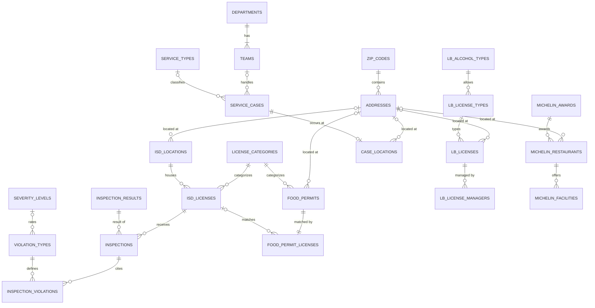

# CS3200 Project: Boston Food Establishments & 311 Data | Janet, Layla, Alexis, Ricky

Boston data on food establishments (licenses, permits, health inspections), Michelin-listed restaurants, and 311 service requests. It is cleaned and then normalized into 24 linked 3NF tables.

```
raw_data/                  original downloads
cleaning/                  cleaning scripts + normalize_all.py
cleaned_data/              food_permits, lb_licenses, michelin_restaurants, 311_service_requests
  food_violations/         licenses, locations, license_categories, inspections,
                           inspection_violations, violation_types
normalized/                final 3NF tables + schema.sql
```

## 1. Original datasets

| File | Rows | Source | Contents |
|---|---|---|---|
| `food_violations.csv` | 907,140 | Boston ISD | Food inspections 2006–2026, one row per cited item; license and address repeated on each row |
| `food_establishment_licenses.csv` | 3,361 | Boston ISD | Active Eating & Drinking permits (FS/FT); no license number |
| `all_establishment_licenses.csv` | 3,559 | Licensing Board | Active victualler, alcohol, inn, club, and misc licenses; MA State Plane coordinates |
| `michelin_my_maps.csv` | 19,721 | Michelin Guide (Kaggle) | Worldwide Michelin restaurants; 15 in Boston |
| `service_requests.csv` | 79,999 | Boston 311 | 311 cases Aug 2025 – Oct 2026 (likely a capped export); see `311_service_requests_data_dictionary.pdf` |

## 2. Cleaning (`cleaning/`)

Pass output paths explicitly, because the scripts' default names differ from what `normalize_all.py` expects.

```
python cleaning/clean_violations.py               raw_data/food_violations.csv              cleaned_data/food_violations
python cleaning/clean_food_licenses.py            raw_data/food_establishment_licenses.csv  cleaned_data/food_permits.csv
python cleaning/clean_licensing_board_licenses.py raw_data/all_establishment_licenses.csv   cleaned_data/lb_licenses.csv
python cleaning/clean_michelin.py                 raw_data/michelin_my_maps.csv             cleaned_data/michelin_restaurants.csv
python cleaning/clean_service.py                  raw_data/service_requests.csv             cleaned_data/311_service_requests.csv
```

All scripts read every column as text so leading zeros survive. They also trim whitespace, pad ZIPs to 5 digits, and parse dates. What each script does beyond that:

| Script | Main steps |
|---|---|
| `clean_violations.py` | Drops `Deleted` (test) licenses; standardizes city names; treats `property_id` `0` as missing; blanks invalid severity levels; splits coordinates. Splits the file into 6 tables (`license_categories`, `locations`, `licenses`, `inspections`, `violation_types`, `inspection_violations`) and checks the keys before writing. |
| `clean_food_licenses.py` | Standardizes neighborhood names (36 values → 16); validates phones; blanks coordinates outside Boston; adds `record_id`, `is_takeout`, and name/address keys. |
| `clean_licensing_board_licenses.py` | Keeps Common Victualler licenses only; blanks placeholders; parses hours to 24-hour time; collapses licenses listed once per manager into one row; parses addresses; converts State Plane to lat/long; validates phones; adds `alcohol_type` and name keys. |
| `clean_michelin.py` | Filters to Boston, MA; parses address and ZIP; adds `stars`, `price_level`, `is_bib_gourmand`, and `michelin_id`. |
| `clean_service.py` | Drops empty photo columns; merges "Resolved successfully" into "Resolved"; restores ZIP zeros; blanks coordinates outside Boston; adds SLA and timing fields. |

## 3. Normalization (`cleaning/normalize_all.py`)

```
python cleaning/normalize_all.py cleaned_data normalized
```

The script writes 24 CSVs plus `schema.sql`, after checking that every primary key is unique and every foreign key resolves.

**Standardization for joins**
- **Addresses:** one parser handles every source's format, and every location row links to a shared `addresses` table.
  - The key is `NUMBER DIR NAME|ZIP`. It leaves out the street suffix because ISD permits omit it, and includes the ZIP because street names repeat across neighborhoods.
- **ZIPs:** link to a shared `zip_codes` table.
- **Business names:** one shared `name_key` (lowercase, ASCII, no punctuation, no LLC/Inc).
- **Formats:** neighborhoods are title-cased; phones are 10 digits; timestamps are UTC; coordinates are WGS84.

**3NF changes**
- Lookups moved into their own tables, and multi-valued cells split into child tables (Licensing Board managers, Michelin facilities).
- Derived columns dropped.
- Food permits are linked to ISD licenses through `food_permit_licenses`: 3,262 matched on name, 40 on property ID, 99 unmatched.
- Kept on purpose: `name_key` columns as match keys, and coordinates, ZIP, and neighborhood on each location row. Records at the same address don't always agree on those values.

## 4. Final tables (`normalized/`)

| Table | Rows | PK | FKs / notes |
|---|---|---|---|
| **Shared** | | | |
| `zip_codes` | 44 | `zip_code` | `in_boston` flag |
| `addresses` | 39,337 | `address_id` | `zip_code`; `address_key` unique, `address_std` display form |
| **ISD inspections & permits** | | | |
| `license_categories` | 4 | `category_code` | FS, FT, RF, MFW |
| `isd_locations` | 5,679 | `location_id` | `address_id`, `zip_code`; `property_id`, lat/long |
| `isd_licenses` | 11,391 | `licenseno` | `category_code`, `location_id`; active + inactive |
| `food_permits` | 3,361 | `permit_id` | `category_code`, `address_id`, `zip_code` |
| `food_permit_licenses` | 3,361 | `permit_id` | `licenseno`; `match_method` |
| `inspection_results` | 20 | `result_code` | label and outcome (pass/fail/closure/admin/error) |
| `inspections` | 223,525 | `inspection_id` | `licenseno`, `result_code` |
| `severity_levels` | 3 | `severity_level` | Minor / Major / Critical |
| `violation_types` | 462 | `violation_code` | `severity_level` |
| `inspection_violations` | 845,034 | `violation_id` | `inspection_id`, `violation_code`; Pass/Fail, comments |
| **Licensing Board** | | | |
| `lb_alcohol_types` | 5 | `alcohol_type` | `serves_alcohol` |
| `lb_license_types` | 23 | `license_type` | `alcohol_type` |
| `lb_licenses` | 2,534 | `license_num` | `license_type`, `address_id`, `zip_code`; hours, capacity |
| `lb_license_managers` | 2,548 | (`license_num`, `manager`) | |
| **Michelin** | | | |
| `michelin_awards` | 3 | `award` | `stars`, `is_bib_gourmand` |
| `michelin_restaurants` | 15 | `michelin_id` | `award`, `address_id`, `zip_code` |
| `michelin_facilities` | 21 | (`michelin_id`, `facility`) | |
| **311** | | | |
| `departments` | 14 | `department_id` | |
| `teams` | 58 | `team_id` | `department_id` |
| `service_types` | 76 | `service_type_id` | `case_topic` |
| `service_cases` | 79,999 | `case_id` | `service_type_id`, `team_id`; dates, on-time, closure |
| `case_locations` | 79,990 | `case_id` | `address_id`, `zip_code`; districts, ward/precinct |

Read ZIP, ward, precinct, phone, and ID columns as text.

## 5. ERD



Every table with a ZIP also references `ZIP_CODES`; those lines are left out of the diagram for readability. `address_id` connects records across sources, and `name_key` adds a business-name match on top of it.
